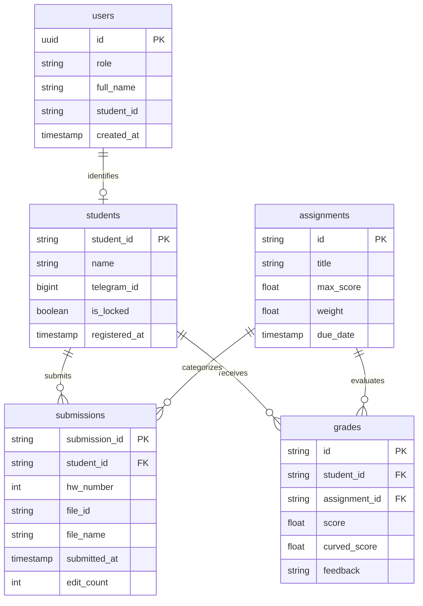

# Grade Flow & Telegram Homework Collector: Unified Educational Platform

[](https://python.org)
[](https://fastapi.tiangolo.com)
[](https://react.dev)
[](https://www.typescriptlang.org)
[](https://tailwindcss.com)
[](https://supabase.com)
[](https://opensource.org/licenses/MIT)

A unified, production-grade academic management ecosystem seamlessly bridging **Telegram-based student submissions** with a **reactive Proportional Grading Web Application** and a **Watermelon UI Telegram Mini App (TMA)** for course instructors and Teaching Assistants.

---

## 📑 Table of Contents
1. [System Architecture](#-system-architecture)
2. [Repository Structure](#-repository-structure)
3. [Core Subsystems](#-core-subsystems)
   - [Telegram Homework Collector & TMA Admin Hub](#1-telegram-homework-collector--tma-admin-hub)
   - [Grade Flow Web Application & Proportional Engine](#2-grade-flow-web-application--proportional-engine)
   - [Unified Supabase PostgreSQL Data Layer](#3-unified-supabase-postgresql-data-layer)
4. [Watermelon Design System](#-watermelon-design-system)
5. [Data Contracts & Schema Mapping](#-data-contracts--schema-mapping)
6. [Quickstart & Local Development](#-quickstart--local-development)
7. [Running Test Suites](#-running-test-suites)
8. [Production Deployment](#-production-deployment)
9. [Clean Public Repo Security Doctrine](#-clean-public-repo-security-doctrine)

---

## 🏛 System Architecture

The ecosystem eliminates fragmented spreadsheets and manual grading reconciliation by synchronizing all student activities across Telegram and the Web platform via a single PostgreSQL source of truth.

```mermaid
flowchart TD
    subgraph Telegram_Ecosystem ["Telegram Ecosystem"]
        S["👨‍🎓 Students"] -->|Direct Messages / Commands| B["🤖 Telegram Homework Collector Bot<br/>(python-telegram-bot + FastAPI)"]
        TA["👩‍🏫 Teaching Assistants"] -->|Telegram Mini App (TMA)| TMA["🍉 TA Control Hub<br/>(Watermelon UI Mini App)"]
        B -->|Forward Submissions| AG["📁 Telegram Supergroup Forum<br/>(HW1..HW5 Dedicated Topics)"]
    end

    subgraph Data_Layer ["Unified Persistence (Supabase PostgreSQL)"]
        DB[("🐘 PostgreSQL Database<br/>- public.users<br/>- public.students<br/>- public.submissions<br/>- public.grades<br/>- public.assignments")]
        VIEW["👁️ student_grades_roster<br/>(Consolidated Reporting View)"]
        DB --- VIEW
    end

    subgraph Web_Ecosystem ["Web Grading & Analytics"]
        GF["⚡ Grade Flow Web App<br/>(React 18 + Vite + TypeScript)"]
        ENG["📐 Proportional Grading Engine<br/>(Linear Curves, Weighting, Grouping)"]
        GF --- ENG
    end

    B <-->|Direct SQL / Async Connection| DB
    TMA <-->|REST API / Session Auth| B
    GF <-->|Supabase JS SDK + Strict RLS| DB
```

---

## 📂 Repository Structure

```
Bot & Grade Flow/
├── .gitignore                   # Clean Public Repo security doctrine
├── .env.example                 # Unified environment template
├── README.md                    # Primary documentation (this file)
│
├── bot/                         # Telegram Bot & TMA Admin Hub
│   ├── api/
│   │   └── index.py             # Serverless Vercel FastAPI handler
│   ├── templates/
│   │   ├── tma_app.html         # Watermelon UI Telegram Mini App frontend
│   │   ├── db_students_template.csv
│   │   └── db_submissions_template.csv
│   ├── tests/
│   │   ├── test_archive_config.py
│   │   ├── test_keyboard_contracts.py
│   │   ├── test_password_auth.py
│   │   ├── test_roster_loader.py
│   │   └── test_tma_admin.py
│   ├── bot.py                   # Core Telegram bot logic, states & handlers
│   ├── tma_admin.py             # FastAPI REST endpoints for TMA Hub
│   ├── Dockerfile               # Container deployment spec
│   ├── Procfile                 # Process manifest for cloud PaaS
│   ├── pytest.ini               # Pytest configuration
│   ├── requirements.txt         # Python dependencies
│   ├── vercel.json              # Vercel serverless deployment config
│   └── .env.example             # Bot-specific environment variables
│
├── grade-flow/                  # Grade Flow Web Application
│   ├── api/
│   │   └── manage-users.ts      # Vercel serverless user management endpoint
│   ├── public/                  # Static assets & brand icons
│   ├── src/
│   │   ├── components/          # Reusable UI components & dialogs
│   │   ├── context/             # React context (Auth, Grades, State)
│   │   ├── hooks/               # Custom React hooks (useGrades, useAuth)
│   │   ├── services/            # Supabase database & auth clients
│   │   ├── types/               # TypeScript interfaces & domain models
│   │   ├── utils/               # Proportional grading calculation engine
│   │   ├── App.tsx              # Root application router
│   │   ├── index.css            # Watermelon UI Tailwind CSS tokens
│   │   └── main.tsx             # React DOM entrypoint
│   ├── index.html               # Web HTML entrypoint
│   ├── package.json             # NPM package definitions
│   ├── tsconfig.json            # TypeScript configuration
│   ├── vite.config.ts           # Vite bundler & proxy configuration
│   ├── vercel.json              # Vercel SPA routing configuration
│   └── .env.example             # Frontend environment variables
│
└── supabase/                    # Database Migrations & Schemas
    ├── migrations/              # Versioned PostgreSQL migration files
    │   ├── 20261004163400_enable_rls.sql
    │   ├── 20261004182000_auth_trigger.sql
    │   ├── 20261004214120_rls_recursion_fix.sql
    │   ├── 20261005000000_drop_email_column.sql
    │   ├── 20261005110000_audit_and_fix.sql
    │   ├── 20261005120000_base_schema.sql
    │   ├── 20261005120500_strict_rls_policies.sql
    │   └── 20261105130000_student_grades_roster_view.sql
    ├── config.toml              # Supabase CLI project configuration
    └── seed.sql                 # Development database seeds
```

---

## ⚙️ Core Subsystems

### 1. Telegram Homework Collector & TMA Admin Hub

- **Conversational Student Registration:** Validates student ID against official roster, enforces shared course registration password, records Telegram Chat ID, and detects duplicate registrations.
- **Submission Pipeline:** Accepts single or batch PDF/ZIP documents, validates file extensions, hashes file contents to detect duplicates, applies server-side timestamps in Asia/Tehran timezone, and automatically forwards submissions to the course Archive Supergroup in assignment-specific forum topics (HW1–HW5).
- **Edit & Resubmission Window:** Allows students to update their submissions before the hard deadline, maintaining an immutable edit count and audit trail.
- **Watermelon UI Telegram Mini App (`/admin`):**
  - **Adaptive Dual-Mode Layout:** Mobile devices default to high-density, touch-optimized **Student Cards** with compact HW status pills; desktop viewports default to an interactive **Matrix Table** with sticky header and name column.
  - **Comprehensive TA Actions:** Direct in-app broadcast messaging (individual or course-wide), account unlock for locked registrations, live Tehran server time synchronization, and submission counts per assignment.
  - **Direct Mobile Browser Access:** Fully functional inside Telegram or directly in external mobile browsers via token authentication (`?token=` or prompt button).

### 2. Grade Flow Web Application & Proportional Engine

- **High-Precision Proportional Grading Engine:**
  - Evaluates grades across raw scores, scaled benchmarks, and dynamic curves.
  - Supports custom grading rubrics, drop-lowest policies, and weighted assignment categories.
  - Automatic letter grade and GPA computation based on course-defined cutoffs.
- **Role-Based Workspaces:**
  - **Admin / TA Workspace:** Complete roster gradebook, assignment management, proportional formula editor, statistical distribution charts, and batch CSV export.
  - **Student Workspace:** Personalized breakdown displaying raw scores, curved adjustments, relative standing, and instructor feedback.
- **Sub-Second Reactive Sync:** Subscribes to real-time changes via Supabase PostgreSQL streaming.

### 3. Unified Supabase PostgreSQL Data Layer

- **`public.users`:** Global identity records mapping UUIDs to roles (`admin`, `student`, `ta`).
- **`public.students`:** Official course roster records (`student_id`, `name`, `telegram_id`, `is_locked`, `registered_at`).
- **`public.submissions`:** Submission logs (`submission_id`, `student_id`, `hw_number`, `file_id`, `file_name`, `timestamp`, `edit_count`).
- **`public.grades`:** Grade records linking `student_id` with `assignment_id`, raw score, curved score, and feedback.
- **`public.assignments`:** Course assignments with max score, weight, due date, and formula parameters.
- **`public.student_grades_roster`:** Unified SQL view joining student identity, assignment submissions, and calculated grades into a flat analytics query.

---

## 🍉 Watermelon Design System

Both the Grade Flow web app and the Telegram Mini App implement the **Watermelon Design System**—a high-contrast, modern dark aesthetic inspired by reactive minimalist dashboards:

| Token | Hex Value | Purpose |
| :--- | :--- | :--- |
| `--wm-bg` | `#080c14` | Deep Obsidian background canvas |
| `--wm-canvas` | `#0c121e` | Secondary canvas backing |
| `--wm-surface` | `#10192a` | Elevated cards, sidebars, and panels |
| `--wm-green` | `#10b981` | Emerald Rind accent for success, active tabs, and primary CTAs |
| `--wm-green-glow` | `rgba(16, 185, 129, 0.22)` | Vibrant emerald focus and active button glows |
| `--wm-pink` | `#f43f5e` | Juicy Coral Flesh accent for alerts, errors, and danger actions |
| `--wm-pink-glow` | `rgba(244, 63, 94, 0.22)` | Coral shadow glows for destructive modal triggers |
| `--wm-cyan` | `#38bdf8` | Informational badges and monospace code highlights |
| `--wm-amber` | `#f59e0b` | Warnings and pending submission state |

**Mobile Touch Ergonomics:**
- iOS Safari and Android Chrome double-tap zoom delay eliminated via `touch-action: manipulation`.
- Viewport boundaries pinned with `100dvh` and CSS `env(safe-area-inset-top)` / `env(safe-area-inset-bottom)`.
- Input fields enforce `font-size: 16px` to prevent iOS automatic zoom on focus.
- Telegram WebApp vertical pull-to-close gesture disabled via `tg.disableVerticalSwipes()` to allow smooth card scrolling.

---

## 📊 Data Contracts & Schema Mapping

The following entity-relationship diagram illustrates how bot activities link directly into the Grade Flow grading pipeline:



---

## 🚀 Quickstart & Local Development

### Prerequisites
- **Python 3.10+**
- **Node.js 18+** & **npm 9+**
- **Supabase CLI** (optional for local database container)

### 1. Clone the Repository
```bash
git clone https://github.com/AliRicky/gradeflow-homework-bot.git
cd gradeflow-homework-bot
```

### 2. Configure Environment Variables
Copy `.env.example` to `.env` in the root (or individually within `bot/` and `grade-flow/`):
```bash
cp .env.example .env
```
Fill in your Telegram Bot Token from `@BotFather` and your Supabase PostgreSQL credentials.

### 3. Initialize & Run Telegram Bot
```bash
cd bot
python3 -m venv venv
source venv/bin/activate
pip install -r requirements.txt

# Run bot in polling mode (for local development)
python bot.py
```

To run the TMA Admin API locally:
```bash
uvicorn api.index:app --reload --port 8000
```
Open `http://localhost:8000/admin` in your browser.

### 4. Initialize & Run Grade Flow Web App
```bash
cd ../grade-flow
npm install
npm run dev
```
Open `http://localhost:5173` to access the Grade Flow web application.

---

## 🧪 Running Test Suites

Both subsystems include comprehensive test suites verified for regression-free operation.

### Running Bot Tests (60 Unit & Integration Tests)
```bash
cd bot
pytest tests
```
*Coverage highlights:*
- `test_archive_config.py`: Forum topic IDs, group IDs, and forwarding contracts.
- `test_keyboard_contracts.py`: Callback queries, inline keyboards, and button payloads.
- `test_password_auth.py`: Registration password validation, duplicate lock prevention, and rate limits.
- `test_roster_loader.py`: Precedence hierarchy (Env CSV vs Database vs File), fallback parsing.
- `test_tma_admin.py`: FastAPI endpoints, clock skew leeway, admin token auth, reset actions, and broadcast validation.

### Running Grade Flow Tests (77 Unit & Component Tests)
```bash
cd grade-flow
npm test
```
*Coverage highlights:*
- Proportional grade curve algorithms.
- Drop-lowest rule calculations.
- CSV import/export data fidelity.
- Strict RLS client authentication boundaries.

---

## 🌐 Production Deployment

### 1. Telegram Bot on Vercel Serverless
1. Link the repository to Vercel:
   ```bash
   vercel
   ```
2. Configure environment variables in the Vercel Dashboard:
   - `BOT_TOKEN`
   - `POSTGRES_URL`
   - `ARCHIVE_GROUP_ID`
   - `TOPIC_HW1` through `TOPIC_HW5`
   - `REGISTRATION_PASSWORD`
   - `ADMIN_CHAT_IDS`
3. Set the Telegram Webhook:
   ```bash
   curl -F "url=https://your-domain.vercel.app/" https://api.telegram.org/bot<YOUR_BOT_TOKEN>/setWebhook
   ```
4. Set the Telegram Mini App Menu Button:
   ```bash
   curl -X POST https://api.telegram.org/bot<YOUR_BOT_TOKEN>/setChatMenuButton \
     -H "Content-Type: application/json" \
     -d '{"menu_button": {"type": "web_app", "text": "Control Hub", "web_app": {"url": "https://your-domain.vercel.app/admin"}}}'
   ```

### 2. Grade Flow Frontend on Vercel
1. Set the root directory to `grade-flow` in Vercel settings.
2. Provide `VITE_SUPABASE_URL` and `VITE_SUPABASE_ANON_KEY`.
3. Build command: `npm run build` | Output directory: `dist`.

---

## 🔒 Clean Public Repo Security Doctrine

This repository strictly adheres to the **Clean Public Repo Doctrine**:
- **Zero Secrets in Git History:** All API tokens, service role keys, connection passwords, and private certificates are excluded via root and child `.gitignore` rules.
- **Zero Student PII:** Official student rosters, phone numbers, Telegram Chat IDs, and student credentials are never committed. Templates (`db_students_template.csv`) provide sanitized schemas for deployment.
- **Sanitized Test Fixtures:** Unit tests execute against mock fixtures and offline in-memory states without requiring live database connections or active Telegram bots.

---

## 📄 License
This project is licensed under the [MIT License](LICENSE).
